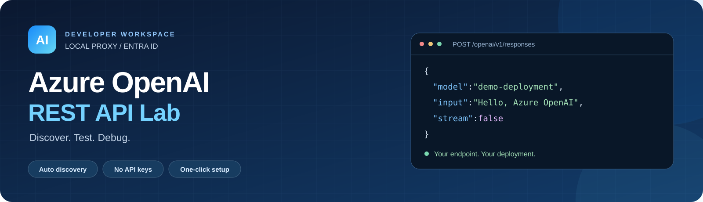
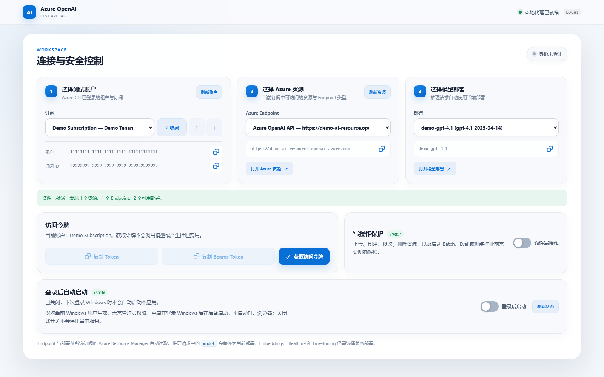
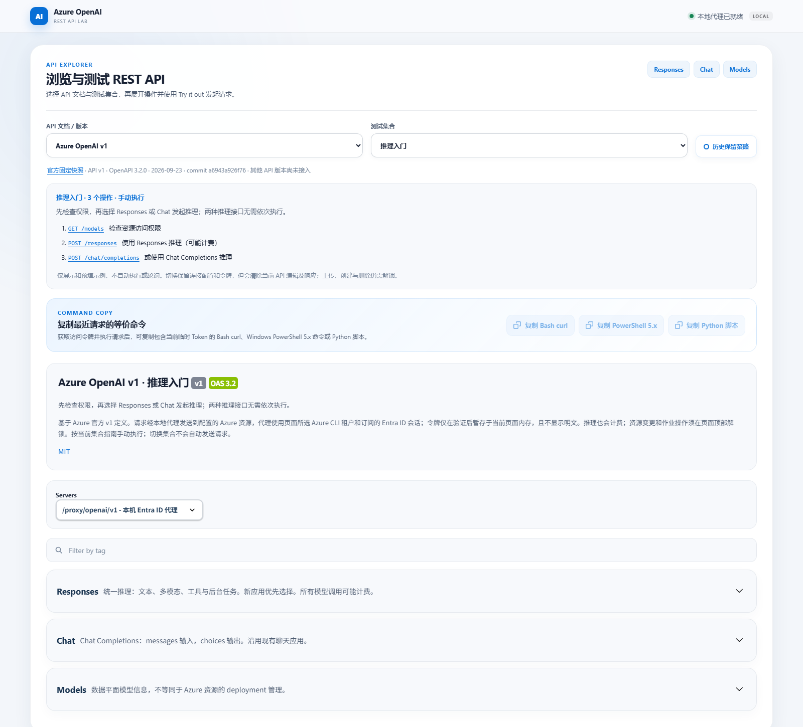

# Azure OpenAI 本地 Swagger 测试站点

基于 Azure 官方 OpenAPI 固定快照，覆盖 **14 类 API、完整请求/响应 Schema**。
浏览器访问本地 Swagger UI，由 Python 代理通过 Azure CLI 获取 Microsoft Entra ID 令牌并调用 Azure；无需 API Key。

## Quick Start

**Windows 一键安装并启动**：在普通 PowerShell 窗口粘贴以下整段命令。无需预先安装 Git、Python、Node.js 或 Azure CLI；缺少的工具由 Windows 的 `winget` 安装。安装器可能请求管理员确认，Azure 登录可能要求浏览器交互或 MFA，这些不能自动跳过。

**公开仓库下载入口：**

只复制下面代码块中的命令，不要复制终端提示符（`PS C:\…>`、`>>`）、运行输出或报错文本。如果终端正在等待续行输入，先按 `Ctrl+C` 取消再粘贴。

```powershell
$setup = Join-Path $env:TEMP ("aoai-setup-" + [guid]::NewGuid().ToString("N") + ".ps1")
try {
    Invoke-WebRequest -UseBasicParsing -Uri ("https://raw.githubusercontent.com/chunxli/AOAI-API-Swagger/main/setup.ps1?nocache=" + [guid]::NewGuid().ToString("N")) -Headers @{ "Cache-Control" = "no-cache" } -OutFile $setup -ErrorAction Stop
    & powershell.exe -NoProfile -ExecutionPolicy Bypass -File $setup
    if ($LASTEXITCODE -ne 0) { throw "Setup failed. See the error above." }
} finally {
    if (Test-Path -LiteralPath $setup) { Remove-Item -LiteralPath $setup -Force }
}
```

每次下载使用唯一查询参数并请求不使用缓存，避免更新后短时间内仍运行旧脚本。如果刚更新后仍出现相同错误，请重新复制上面的完整命令，不要复用此前下载的脚本。

仓库仍为 **Private** 时，匿名下载地址会返回 404。请先登录 GitHub，从 [setup.ps1](setup.ps1) 的文件页面下载脚本（无需先克隆整个仓库），在下载目录执行以下命令；克隆时仍需具有仓库访问权限，按 Git 凭据管理器的提示完成 GitHub 认证：

```powershell
powershell.exe -NoProfile -ExecutionPolicy Bypass -File .\setup.ps1
```

只运行从本项目取得并审阅过的脚本。`ExecutionPolicy Bypass` 仅用于这次 PowerShell 子进程，不修改系统执行策略，也不能绕过组织策略。

脚本会依次执行：

1. **Pre-check / 工具安装**：检查 Windows、Git、Python 3.10+、Node.js/npm、Azure CLI；缺失时通过 winget 安装 Git、Python 3.12、Node.js LTS 或 Azure CLI，刷新当前进程的 PATH。
2. **Clone / Update**：首次默认克隆到 `%LOCALAPPDATA%\AzureOpenAILab`；已有本项目仓库时，确认位于 `main` 且工作区干净，再执行 `git pull --ff-only --no-rebase origin main` 更新代码。在已有项目目录运行脚本时使用该目录。
3. **Install**：创建项目 `.venv`、安装固定的 Python 依赖和本地 Swagger UI 静态资源。
4. **Azure 登录**：已有有效登录则复用，否则执行 `az login`。验证 ARM 令牌时不输出 Token，不修改 CLI 默认订阅，也不会创建 Azure 资源或调用模型。
5. **Start**：启动或重启本站后台服务，验证健康状态，再打开浏览器。页面自动发现账户、Endpoint 和模型部署；**无需创建配置文件**。

完成后通常访问 **http://127.0.0.1:8765**（可选配置覆盖端口时以脚本输出为准），选择订阅、Endpoint 和部署后即可测试。Windows 登录后自启动默认关闭，可在页面中自行开启；脚本不会修改此选择。

## 应用截图

以下为实际 WebApp 的界面局部截图，使用隔离预览环境中的**虚构演示数据**：账户、租户、订阅、资源地址和部署均不是个人生产配置。截图未获取真实 Azure Token，也未调用模型。

### 连接与安全控制

自动发现账户、Endpoint 与模型部署，提供 Azure 资源和部署快捷入口、访问令牌操作、写操作保护及 Windows 登录后自启动开关。



### API Explorer

按测试集合浏览官方 API 定义，查看操作指南、请求历史策略及 Bash、PowerShell、Python 等价命令入口；所有真实请求都需手动执行。



## Setup 详细说明

### 脚本参数与前置条件

下载脚本或进入已有仓库后，可按需指定安装目录，或者只做只读工具检查：

```powershell
powershell.exe -NoProfile -ExecutionPolicy Bypass -File .\setup.ps1 -InstallDirectory "$env:USERPROFILE\Dev\AzureOpenAILab"
powershell.exe -NoProfile -ExecutionPolicy Bypass -File .\setup.ps1 -CheckOnly
```

- 支持 Windows PowerShell 5.1+。请以实际使用 Azure 的 Windows 用户运行，不要切换成另一个管理员账号，否则登录凭据和自启动设置也属于那个账号。
- PATH 中存在多个同名程序（例如同时存在传统 Python Launcher 与 WindowsApps 的 `py.exe`）时，脚本按命令搜索顺序只选择第一个匹配路径，不会将多个路径拼成一条命令。
- 缺少工具且找不到 `winget` 时，脚本会停止并提示安装 Microsoft Store 中的 **App Installer / 应用安装程序**，或手动安装下面列出的工具。已有全部工具时无需 winget。
- winget 安装会接受相关软件及源协议，可能触发 UAC；组织禁用安装、要求重启或 PATH 尚未生效时会明确报错，处理后可重新执行。脚本不静默忽略失败。
- 需要联网访问 GitHub、Python 包源、配置的 npm registry、winget 源及 Azure 登录/管理服务；安装脚本遵循 npm 已有的 registry、代理和 CA 配置，不强制切换到公共源。企业代理或包源认证需由当前环境配置。
- 脚本只会快进更新已有本项目仓库的 `main` 分支，不会强制覆盖、自动 stash、切换分支或删除不完整的 `.venv`。目录非空但不是本项目仓库时会拒绝使用。重跑脚本会更新代码、安装依赖并重启本站服务，当前进行中的请求可能中断。
- 自动安装、登录及打开浏览器需要实际 Windows 环境和用户交互；`-CheckOnly` 只检查工具，不进行克隆、代码更新、安装、Azure 登录或服务启动。

### 更新已安装的版本

**再次运行顶部 Quick Start 即可更新并重启**：下载最新版安装脚本后，它会检测默认安装目录中的已有仓库，依次更新代码、同步依赖、检查 Azure 登录，再重启服务并验证健康状态。即使没有新提交，也会同步依赖并重启，便于重试未完成的安装。无需删除原安装目录。

如果首次使用了自定义目录，请在下载最新版 `setup.ps1` 后指定同一目录：

```powershell
powershell.exe -NoProfile -ExecutionPolicy Bypass -File .\setup.ps1 -InstallDirectory "$env:USERPROFILE\Dev\AzureOpenAILab"
```

旧版安装脚本本身没有自动更新逻辑，首次升级时请重新下载最新版，不要只运行旧目录里的旧脚本。被 Git 忽略的 `config.json`、`.runtime`、`.venv` 和 `node_modules` 会保留；依赖安装阶段会更新虚拟环境和 npm 包。

发现本地修改（含暂存或未跟踪文件）、非 `main` 分支、分支分叉或拉取失败时，脚本明确停止，不会自动解决冲突，也不会进入依赖安装和服务重启。先自行备份或处理本地改动及 Git 问题后重跑。若代码更新成功但后续依赖安装或登录失败，脚本同样不会重启正在运行的服务，但不会自动回滚已更新的代码或依赖。

### 手动 setup（可选）

如果不使用一键脚本，按以下步骤执行：**安装运行环境 → 安装项目依赖 → 登录 Azure → 启动服务**。无需创建配置文件或手填 Endpoint、部署名称。

#### 1. 准备环境并获取代码

- 安装 Git、Python 3.10+、Node.js（含 npm）和 Azure CLI，安装后重新打开 PowerShell。
- 准备可访问的 Azure OpenAI / Microsoft Foundry 资源及模型部署。Azure 账户需具备所选订阅的资源读取权限，以及模型推理权限（例如资源上的 `Cognitive Services OpenAI User`）。
- 本应用不会创建 Azure 资源或模型部署，也不需要配置 API Key。

```powershell
git clone https://github.com/chunxli/AOAI-API-Swagger.git
cd .\AOAI-API-Swagger
```

仓库为 Private 时，克隆需要相应的 GitHub 访问权限；已有代码则直接进入包含 `server.py` 的项目目录。

#### 2. 安装依赖

```powershell
python -m venv .venv
.\.venv\Scripts\python.exe -m pip install -r requirements-lock.txt
npm install --ignore-scripts --no-audit --no-fund
```

Python 依赖安装到项目的 `.venv`，npm 安装本地 Swagger UI 静态资源。仓库不包含 `package-lock.json`，首次安装请用 `npm install` 而不是 `npm ci`；生成的锁文件仅保留在本机。

如果 npm 报 `ERR_SSL_SSL/TLS_ALERT_HANDSHAKE_FAILURE`，说明下载包时 TLS 握手失败，不是 Python 安装失败。先用 `npm config get registry` 检查当前包源；企业网络应使用组织批准的包源、代理及 CA 配置，不要通过 `strict-ssl=false` 或 `NODE_TLS_REJECT_UNAUTHORIZED=0` 关闭校验。修复网络配置或更新安装脚本后，可用 `-InstallDirectory` 指向原安装目录重跑，已有仓库和有效 `.venv` 会复用。

如果包源返回 `EALLOWREMOTE` / `Fetching packages of type "remote" have been disabled`，表示包源策略禁止获取某些依赖。请联系管理员批准所需依赖或提供可用的受批准包源；脚本不会改用其他源绕过该策略。

#### 3. 登录 Azure 并启动

```powershell
az login
# 多租户时使用：az login --tenant "<tenant-id>"
.\start.ps1
```

打开 **http://127.0.0.1:8765**，依次选择订阅、Endpoint 和模型部署，等待资源加载完成后点击“获取访问令牌”，再展开 API 开始测试。

即使尚未安装 Azure CLI 或尚未登录，WebApp 本身也可以启动；页面会显示安装或登录提示。自动发现需要 `az` 在服务进程的 PATH 中可用、已执行 `az login`，并具备资源读取权限。发现资源不会自动创建部署或发送模型推理请求；未选择 Endpoint 时 Execute 会明确报错，不会使用虚构地址。

首次 setup 到此完成。以后通常只需运行 `.\start.ps1`；Azure 登录过期时重新运行 `az login`。如需登录 Windows 后自动后台启动，在页面“登录后自动启动”卡片中开启开关，默认关闭。

**注意：Execute 会访问真实 Azure API，推理、存储和作业可能计费。**

## Azure CLI 版本与登录要求

- 不绑定某个精确的 Azure CLI 版本，建议安装最新稳定版。本轮本机验证使用 **Azure CLI 2.91.0**；未对所有旧版建立兼容性矩阵，因此不宣称未经验证的最低版本。
- 应用使用内置的 `az account list --output json --only-show-errors` 读取账户；Python `azure-identity` 的 `AzureCliCredential` 通过 `az account get-access-token` 获取令牌，按所选订阅或租户请求。不执行 `az account set`，不改动 CLI 的默认订阅。
- 资源与部署列表直接调用 Azure Resource Manager REST API，不依赖 `az cognitiveservices` 命令、Foundry/OpenAI 扩展或 CLI 内置的相应服务 API 版本。这里只支持 Azure 公有云 Endpoint。
- 安装或升级 CLI 后重新打开终端，并重启 WebApp，确保后台进程获取更新后的 PATH。可用以下命令检查版本及登录状态（不会输出访问令牌）：

  ```powershell
  az version
  az account list --output table --only-show-errors
  ```

- 账户为空、登录失效或缺少读取权限时，页面会明确报错。“选择测试账户”卡片中的“重新登录或切换账户”提供可复制的具体命令：选中订阅时为该租户生成 `az login --tenant '<当前租户 ID>'`；没有账户时显示 `az login`。账户读取失败或认证失败时会自动展开指引。
- 如需切换为其他登录账户，指引提供 `az logout` 后再执行 `az login`，并提示退出会影响同一 Windows 用户下其他依赖 Azure CLI 登录的工具。请在运行本站的同一 Windows 用户下手动执行，完成后点击“刷新账户”，重新选择订阅、Endpoint 和部署；网页不会替你执行登录或退出命令。全量 Swagger Schema 不代表所选模型、区域和账户权限支持全部接口。
- Windows 下使用同步 `AzureCliCredential` 在线程中获取令牌，按系统编码处理 CLI 输出，避免异步 SDK 将本地编码的错误输出强行按 UTF-8 解码而导致 500；不会阻塞 WebApp 的异步事件循环。真实登录错误仍会明确返回，不会伪装成认证成功。
- 页面遇到非 JSON 错误响应时会显示 HTTP 状态码和日志位置，而不是 `Unexpected token`。请查看安装目录下 `.runtime/server.stderr.log` 的 Traceback；分享日志前删除 Token 等敏感内容。

参考：[AzureCliCredential](https://learn.microsoft.com/en-us/python/api/azure-identity/azure.identity.azureclicredential?view=azure-python)、[az account](https://learn.microsoft.com/en-us/cli/azure/account?view=azure-cli-latest)。

## 可选本地配置

**正常使用无需创建 `config.json`。** 无此文件时使用端口 `8765`、请求超时 `180` 秒、上传上限 `32 MiB` 和 `https://ai.azure.com/.default` Token scope；账户、Endpoint 和部署由页面发现并选择。

仅需修改默认设置时，在项目根目录创建 UTF-8 编码的 `config.json`，只填写要覆盖的字段。例如改变监听端口：

```json
{
  "port": 9000
}
```

此时访问 `http://127.0.0.1:9000`。启动、重启、状态检查与登录后自启动使用同一份默认值和配置校验逻辑。

- 可选字段还包括 `request_timeout_seconds`、`max_upload_mb`、`token_scope` 和 `tenant_id`。`tenant_id` 默认留空；scope 也支持明确设置为 `https://cognitiveservices.azure.com/.default`，不会自动回退。
- 兼容已有配置中的 `endpoint`、`deployment`、`embedding_deployment`；它们不再是必填项，可留空。配置 Endpoint 时必须是 Azure 公有云 HTTPS 资源根地址，不附加 `/openai/v1`；部署名称不一定等于基础模型名。页面选择的资源和部署优先用于请求，Embeddings 等接口仍需选择兼容模型。
- 配置文件存在但 JSON 或字段格式无效时会明确报错，而不是悄悄使用默认值。修改配置后需重启服务。
- `config.json`、`package-lock.json`、`.venv`、`node_modules` 和 `.runtime` 均已被 Git 忽略。不要填入密钥、密码或 Token，也不要强制提交个人资源配置及请求历史。

## 启动与服务管理

`start.ps1` 默认在后台启动，不显示服务运行日志窗口，启动完成后终端可以直接关闭。安装/更新重启和 Windows 登录自启动均复用此后台模式；只有显式使用 `-Foreground` 才在终端显示运行日志。安装进度和 Azure 登录需要交互的窗口仍会保留。常用服务命令：

```powershell
.\start.ps1                 # 后台启动；已运行时直接显示当前 PID
.\restart.ps1               # 快速重启并等待服务恢复
.\stop.ps1                  # 停止后台服务
.\service.ps1 status        # 查看状态、PID 和访问地址
.\start.ps1 -Foreground     # 前台启动，用 Ctrl+C 停止
```

打开 **http://127.0.0.1:8765**。脚本可以从任意目录调用，并按自身目录寻找配置及依赖。
后台 PID 和 stdout/stderr 日志保存在 `.runtime`，日志直接写入文件，不在服务窗口滚动显示；停止和重启会校验 PID 对应的命令行，只管理本站进程。后台服务保留隐藏控制台供 Azure CLI 子进程继承，避免无控制台启动方式导致 CLI 另外弹窗。需要排错时可手动查看：

```powershell
Get-Content -LiteralPath .\.runtime\server.stderr.log -Tail 80
Get-Content -LiteralPath .\.runtime\server.stdout.log -Tail 80
```

## 登录 Windows 后自动启动

在页面“连接与安全控制”下的“登录后自动启动”卡片中开启“登录后启动”，即可在机器重启并登录当前 Windows 用户后自动后台启动。默认不注册自启动，也不自动打开浏览器。无需管理员权限或保存 Windows 密码；未登录 Windows 时不会启动。

- 设置直接读取和更新当前用户的 `HKEY_CURRENT_USER\Software\Microsoft\Windows\CurrentVersion\Run`，不是浏览器本地存储。注册表值名为 `AzureOpenAILab-<应用路径哈希>`，不同应用目录相互独立。
- 登录时通过 Windows PowerShell 隐藏运行本站 `start.ps1`，复用现有进程检查、端口检查及日志机制。当前服务已启动时不会重复启动。
- 关闭开关只移除本站对应的自启动项，不会停止当前服务，也不会修改其他启动项。可点击“刷新状态”读取实际 Windows 设置；权限、组策略或保存错误会明确显示。
- 启用后请保留应用目录和 `.venv`。移动或删除应用前先关闭开关，到新目录启动后再重新开启。Windows 自启动命令有 260 字符限制，路径过长时页面会明确报错。
- Windows 可能延迟登录启动，系统启动应用设置或组织策略也可能禁用执行。下次登录后可访问本站地址或用 `.\service.ps1 status` 检查，启动失败时查看 `.runtime` 日志。
- 自动启动不等于自动登录 Azure。仍使用该 Windows 用户的 Azure CLI 凭据，登录过期时需重新执行 `az login`。关闭网页不影响后台服务。

## 使用流程

1. 从“Azure CLI 测试账户”选择已登录的租户和订阅；常用订阅可点击“收藏”，收藏项会在下拉列表顶部单独显示。页面随后通过 Azure Resource Manager 自动加载可访问的 Azure OpenAI Endpoint 和部署。
2. 选择 Endpoint 和模型部署，再点击“获取访问令牌”。只获取数据平面令牌，不运行推理；不代表 RBAC 验证成功。验证后可点击“复制 Token”，页面不会显示令牌明文。
   资源卡片的“打开 Azure 资源”和部署卡片的“打开模型部署”分别在新标签页打开对应的 Azure Portal 资源与 Microsoft Foundry 部署详情。链接随当前选择更新，加载中或没有对应资源/部署时不可用；目标门户仍需登录并具备相应权限。
   查询资源期间，两张卡片显示醒目的动态进度条与等待说明，完成或失败后自动收起。接口不提供完成百分比，因此进度条只表示正在加载；浏览器启用减少动态效果时显示静态进度条。
3. 展开 **Models → GET /models → Try it out → Execute** 测试实际资源访问。
4. 展开 **Responses → POST /responses** 或 **Chat → POST /chat/completions**，检查输入后 Execute；请求中的 `model` 会替换为页面当前选择的部署。
5. 根据 HTTP 状态、响应 Body、`apim-request-id` / `x-request-id` / `x-ms-client-request-id` 排查。
6. 删除、上传、创建资源及启动作业前，勾选“允许资源变更 / 作业操作”。该选项只在当前页面生效，刷新即重置。
7. 每个 API 展开区域底部都有“请求历史”。历史默认永久保存，可查看详情、下载原始请求/响应或将参数恢复到 Try it out；恢复后仍需手动 Execute。
8. 获取访问令牌并执行请求后，可在 API Explorer 顶部复制等价的 Bash `curl`、Windows PowerShell 5.x 命令或 Python `httpx` 脚本。命令直接调用所选 Azure Endpoint，并嵌入页面内存中最近一次获取或刷新的临时 Bearer Token，不会再次调用 Azure CLI，也不包含本机代理的 `X-Lab-*` Header。命令含敏感且有时效性的 Token，请勿分享；文件上传命令还会使用本地路径占位符，运行前需替换为真实文件路径。

**推理、向量化、存储、训练、Batch、Evals 等都可能计费；不是沙箱或 Mock。**
这里的解锁仅是本机误操作保护，不是 Azure 权限授权。真实权限仍由 Azure RBAC 决定。
Entra 身份至少需相应推理权限，例如资源上的 `Cognitive Services OpenAI User`；
训练和资源管理可能需要不同或更高权限。请按最小权限分配。

## 已实现

- 14 分类：Batch、Chat、Completions、Containers、Conversations、Embeddings、Evals、Files、Fine-tuning、Models、Realtime、Responses、Threads、Vector Stores。
- 使用完整官方 OpenAPI 3.2 定义，保留所有组件和字段。在内存中调整服务器地址、认证声明、分类描述及常用示例，并移除指向外部 SDK 示例文件的 `x-ms-examples` 扩展，使 UI 文档自包含；原始快照不变。
- 文件上传 UI 使用小范围适配：原始定义没有声明 `file` 的二进制类型，因此在操作的内联 Schema 中补上 `string/binary`，让 Swagger 显示文件选择器；`expires_after` 展示为实际 multipart 的 `expires_after[anchor]` / `expires_after[seconds]` 字段。原始 components 保持不变。默认文件过期示例为 86400 秒，可根据 Azure 限制修改。
- Swagger UI 5.32.15 本地静态资源；无 CDN，无外部在线 Schema 校验。
- Entra 访问令牌在后端内存缓存，临近过期时重新通过 CLI 获取。验证成功后，页面会在当前标签页内存中暂存令牌供“复制 Token”使用，但不会将明文渲染到页面；刷新页面即清除。
- 页面通过 `az account list` 读取当前 Azure CLI 已登录的租户和订阅。切换账户时，有订阅则按 subscription 获取令牌（订阅已唯一确定租户），无订阅时按 tenant 获取；不执行 `az account set`，不会修改终端中的全局默认订阅。后续 Swagger 请求使用最近一次验证成功的账户。
- 收藏订阅按 subscription ID 和自定义顺序保存在当前浏览器的 `localStorage`，不上传到服务端。收藏项在下拉列表顶部的独立分组中显示，可用上移/下移按钮调整顺序；刷新 Azure CLI 账户或页面后会保留收藏顺序和当前选择。
- Endpoint 和部署通过 Azure Resource Manager `2024-10-01` API 自动发现；需要所选订阅的资源读取权限。后端只接受本次发现且域名通过 Azure 校验的 Endpoint，避免代理到任意地址。
- 每个 API 操作展开后提供对应的 Microsoft Foundry 和 OpenAI 官方文档快捷入口；仅在官方存在匹配文档时显示该侧链接。
- 页面选择的 Endpoint 会决定后续 Swagger 请求目标；Responses、Chat Completions、Completions 和 Embeddings 请求 Body 中的 `model` 会由后端替换为当前部署。Batch 输入 JSONL 内的模型字段不会自动改写。
- 每次 Execute 会同步生成对应的 Bash `curl`、Windows PowerShell 5.x 命令与 Python `httpx` 脚本，保留请求方法、Azure URL、查询参数、业务 Header、请求 Body 和页面最近获取的临时 Token，并应用与代理一致的模型部署替换。账户切换或 Token 刷新开始时会立即清除旧命令，必须在最新 Token 就绪后重新 Execute。PowerShell 普通请求使用 `Invoke-WebRequest -UseBasicParsing`，multipart 上传使用 .NET `HttpClient`；Python 上传脚本使用 `ExitStack` 管理文件句柄。
- 页面复制操作优先使用同步文本选择复制，以兼容 VS Code 集成浏览器未保持文档焦点的场景；不支持时再使用标准 Clipboard API。复制失败会在对应区域显示明确错误。
- 固定 Azure 目标、仅代理官方路径与方法、拒绝重定向、仅监听 `127.0.0.1`，验证 Host / Origin / 本机会话 Header。
- JSON 请求、原始 multipart 文件上传、二进制下载、分页参数和 SSE 透传。
- 客户端可填写 `x-ms-client-request-id`；留空自动生成 UUID，并在本地响应 Header 返回。仅接受 1–128 个字母、数字及 `._:-`。
- Azure HTTP 错误状态和 Body 透传；本地认证/网络错误返回明确 JSON 错误。不会自动重试计费或写入请求。
- 401 会使缓存失效，下一次手动请求重新获取令牌，不重放原请求。
- 日志仅记录方法、路径、状态和客户端请求 ID，不记录请求 Body、令牌或原始认证错误文本。
- 请求历史由本地代理写入 `.runtime/request-history.sqlite3`，按文档、方法和 OpenAPI 路径区分 API。JSON、multipart、上传文件、二进制下载及 SSE 均完整保存，响应列表只读取摘要。每条详情会同时显示浏览器原始请求、后端实际发往 Azure 的最终 URL / Headers / 完整 Body，以及 Azure 响应 Headers / Body；因此可核对模型替换、查询参数和最终转发值。未通过本地校验或认证的请求会明确标为“未发往 Azure”。
- 历史默认永久保留。API Explorer 的“历史保留策略”可改为每个 API 最近 1–10,000 条或最近 1–3,650 天；也可删除单条或清空当前 API。策略变更后会立即清理不符合条件的记录。
- 服务重启不会清除历史数据库；旧页面检测到重启造成的本机会话失效后，会自动获取新会话并重试历史读取，无需手动刷新页面。
- 历史恢复会填回路径、查询、业务 Header、JSON Body 和表单文本字段，但不会自动发送请求。浏览器不允许脚本恢复文件选择框，因此上传文件需重新选择；原上传内容仍可从历史下载。
- 历史记录不会保存访问令牌、API Key、Cookie 或 `X-Lab-*` 控制 Header 的值；实际转发日志中的 `Authorization` 等敏感 Header 只保留名称并将值记为 `<redacted>`。数据库会包含真实提示词、最终转发 Body、响应和上传文件，应按敏感本地数据保护。

## API 文档与测试集合

API EXPLORER 提供“API 文档 / 版本”和“测试集合”两个选择框。第一版只启用已适配的
**Azure OpenAI v1** 官方固定快照，并显示来源、快照日期及提交号；不代表已支持日期版本或 Preview API。

| 集合 | 内容 |
|---|---|
| 全部接口 | 保留完整官方接口与分类 |
| 推理入门 | 3 个操作：Models、Responses、Chat Completions；两种推理接口为替代选择 |
| Batch 测试 | 4 个操作：上传 JSONL、创建 Batch、查询 Batch、下载结果/错误文件 |
| 向量检索 | 6 个操作：独立 Embeddings 测试，以及文件上传、创建向量库、关联文件、检查入库、搜索 |

集合指南可跳转到具体接口，示例相互独立。Batch 集合使用 `/v1/responses` 示例；
上传 JSONL 中的 URL 需与 Batch endpoint 对应，文件中的 `model` 需填写兼容 Batch 的部署名。
Embedding 测试与托管文件检索不是同一条必经流程；Vector Store 会处理文件入库。

- 不自动发起请求、轮询、传递 ID 或创建资源；仍需手动 Execute。
- 切换集合保留账户、Endpoint、部署、令牌及写操作保护状态。
- 编辑过请求、进入 Try it out 或执行过请求后，切换会先确认；确认后清除 API 编辑、文件选择和响应结果。取消则保留原集合。
- 请求执行期间禁止切换；Schema 加载失败时保留原集合并明确提示，可重新选择重试。
- 集合是测试视图，不是权限边界；后端继续按完整的官方 v1 路由白名单和写操作保护校验请求。
- `/api/explorer` 返回文档与集合目录；`/api/openapi.json?document=azure-openai-v1&collection=batch` 返回对应 Schema。
  不带参数的 `/api/openapi.json` 继续返回 v1 全部接口。
- 文档注册和集合定义位于 [specification.py](specification.py) 的 `DOCUMENTS` / `COLLECTIONS`。
  后续新增版本必须先适配代理路径、认证 scope、部署及版本参数，再注册；不支持直接导入任意 URL、
  OpenAPI 文件或将网页文档当作可执行接口。

## 边界与注意事项

- **不是对外部署方案**：不要修改监听地址开放到局域网或公网，不要加反向代理暴露。本机其他拥有等同操作权限的进程也可能访问它。
- Swagger 输出的 curl 指向本机代理，但刻意不含本机会话码，不能直接复制后就绕过保护执行。正式程序请使用原有 Python/PowerShell 示例。
- Realtime 只涵盖 REST 控制面；不提供 WebRTC/WebSocket/SIP 音频客户端。Realtime 的响应可能包含短期 `client_secret`，请勿分享响应截图。
- SSE 由代理流式转发，但 Swagger UI 通常等流结束后再显示，建议初次测试使用 `stream: false`。
- 文件上传默认最大 **32 MiB**，超过返回 413。可按需修改配置；上传缓存在本机内存，因此不适合巨型文件批量传输。Azure 自身仍有额外限制。
- 历史响应大小不设上限并采用分块存储。文件、音频、图片和长时间 SSE 会持续增大 `.runtime/request-history.sqlite3`；请根据磁盘容量配置保留策略。停止服务后可备份该文件；如需彻底清除全部历史，可停止服务后删除该数据库文件，下一次启动会自动重建。
- 接收响应过程中断连时，流会失败并记录错误；HTTP 响应一旦开始，无法再改变其状态码。请结合客户端网络错误和日志判断完整性。
- 长时任务推荐 `background: true` 然后手动查询状态，而不是无限等待同步请求。
- 不会自动调用 Responses、上传文件、创建作业、执行删除或修改 Azure RBAC。
- Threads 保留在官方快照中用于参考；旧 Assistants 生命周期及迁移以官方公告为准，不建议新建应用采用。
- 不提供 Azure ARM 资源/部署管理。`GET /models` 不等同于 Azure 的部署列表。
- 企业网络代理由 HTTPX 的环境配置控制；若连接失败，应检查代理、TLS 信任、DNS 和 Azure 网络访问策略。

## 常见问题

| 现象 | 排查 |
|---|---|
| 401 local-proxy | `az login`、租户、token scope；验证当前 CLI 登录会话 |
| 401/403 Azure | 检查 Azure RBAC、身份、token audience、防火墙/网络策略；角色刚分配可能需等待生效 |
| 403 local-proxy | 检查是否从本机页面操作、是否勾选资源变更、是否使用正确端口 |
| 400 Azure | 模型不支持字段、缺少必填项、请求格式不正确；根据原始错误修改 |
| 404 Azure | 部署名称、API/模型/区域兼容性、资源 ID |
| 429 Azure | 配额/限速；参考 `retry-after` 后手动决定是否重试 |
| 502/504 local-proxy | DNS、TLS、网络代理、Azure 端超时；不会自动重试 |
| 上传 413 | 本机 `max_upload_mb`；Azure 文件大小限制需另外核查 |
| 端口被占用 | 修改配置中的 `port`，重启并使用新 URL；不要终止未知进程 |

## 离线测试

```powershell
.\.venv\Scripts\python.exe -m unittest -v test_server test_startup_settings
node --check .\static\site.js
npm test
powershell.exe -NoProfile -ExecutionPolicy Bypass -File .\test_setup.ps1
```

测试使用假的 Entra credential 和 HTTPX MockTransport，不发送真实 Azure 请求，不会产生费用。
覆盖 Schema 完整性、路径白名单、访问限制、资源操作保护、JSON/multipart/二进制/SSE、
令牌缓存、超时、错误透传、不自动重试，以及历史持久化、内容恢复、隐私过滤和保留策略等行为。
`test_setup.ps1` 在 Windows PowerShell 5.1 下模拟工具安装、克隆、依赖安装与 Azure 登录，覆盖失败中止、保留已有目录、登录复用及启动健康检查；不会实际安装软件、远程克隆或登录 Azure。

当前版本已在 Windows / Python 3.14 上验证。`requirements-lock.txt` 记录该环境中验证过的 Python 包版本，
Swagger UI 版本固定在 `package.json`，生成的 `package-lock.json` 仅保留在本机；升级依赖时可从 `requirements.txt` 的兼容范围安装后重新运行测试。
浏览器验证采用请求拦截模拟 Responses 和文件上传，不代表已连接当前 Azure 资源，也不会自动检查实际部署或 RBAC。

## 官方来源与授权

- [Microsoft Learn v1 生命周期与 OpenAPI 下载入口](https://learn.microsoft.com/en-us/azure/foundry/openai/api-version-lifecycle)
- [Microsoft Entra ID 认证指南](https://learn.microsoft.com/en-us/azure/foundry-classic/openai/how-to/managed-identity)
- 官方快照来源/提交/哈希：[vendor/source.json](vendor/source.json)
- 原始定义：[vendor/azure-openai-v1.json](vendor/azure-openai-v1.json)
- MIT 授权：[Azure LICENSE](vendor/LICENSE-Azure.txt)、[OpenAI LICENSE](vendor/LICENSE-OpenAI.txt)
- Swagger UI 的授权随本地 npm 包保留在 `node_modules/swagger-ui-dist` 中。

这里提供的是人工触发的开发测试工具，不承诺所有当前/未来 Azure 资源支持快照中的每项能力。
